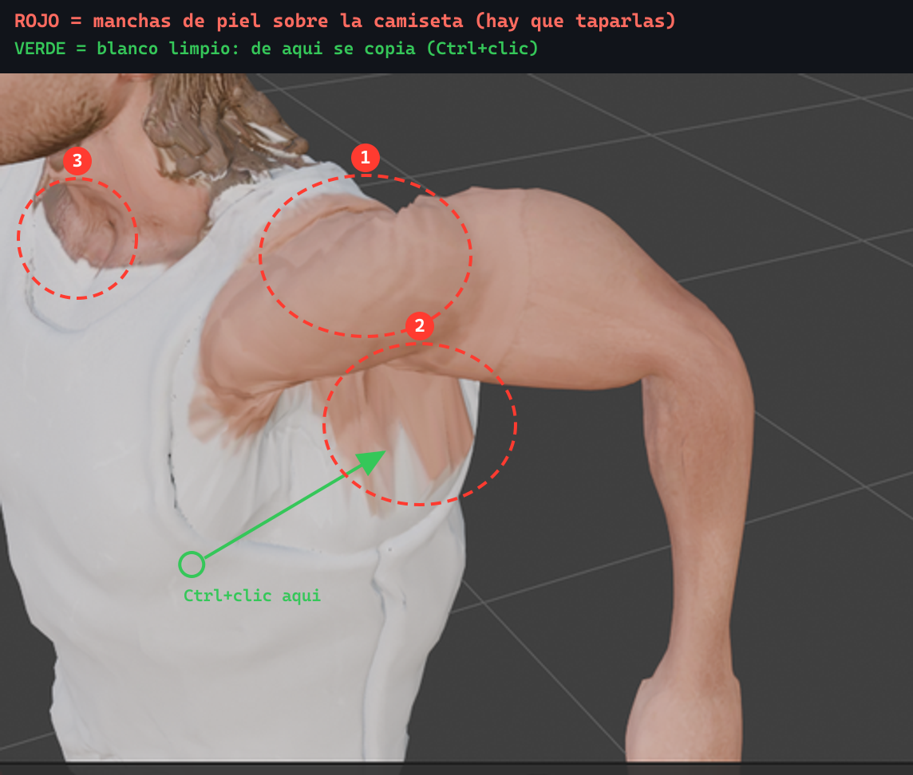

# Retocar a mano la piel derramada sobre la camiseta

El escaneo proyectó tono de piel **encima de la camiseta** en hombros, clavícula
y cuello. No se arregla por script, y esto está medido, no supuesto:

`node scripts/diag-hombro.mjs` cuenta los vértices que **se ven** como piel en la
franja del hombro y mira qué hueso los domina. De 4.239:

| Hueso dominante | Vértices | |
|---|---|---|
| `upper_arm` | 2.087 (49%) | es brazo: repintarlo de blanco lo destruye |
| `shoulder` | 2.034 (48%) | mezcla deltoides y tirante |
| `spine` | 118 (3%) | único alcanzable por una máscara de camiseta |

O sea: **el borde visual piel/prenda no cae donde cambia el hueso**, así que
ninguna máscara construida desde el esqueleto puede separarlos. Se intentó
(`scripts/fix-piel-en-camiseta.mjs`, conservado como documentación del límite) y
el resultado fue pintar blanco sobre el cuello sin apenas tocar la lengüeta.

A mano son unos minutos.

## 1. Abrir la sesión

    blender --python scripts/blender_retoque_personaje.py

En Windows con Blender de la Microsoft Store, `blender` es:

    "C:\Users\<usuario>\AppData\Local\Microsoft\WindowsApps\blender-launcher.exe"

(el `blender.exe` de dentro de `WindowsApps` da *Permission denied* desde bash).

Queda abierto en **Texture Paint** con la textura `bk_final` como lienzo. Si ya
existe la sesión, se abre directamente:

    blender ~/hermes-workspace/scratchpad/f100-backup/personaje-retoque.blend

## 2. Elegir el pincel Clone

**Esto hay que hacerlo a mano**: desde Blender 4.3 los pinceles son *assets* y
el script no puede seleccionarlos de forma fiable. Al abrir verás `Paint Hard`
arriba a la izquierda.

En la **barra de pinceles de abajo**, pestaña `All`, busca el icono de **Clone**
(dos hojas superpuestas, al final de la fila) y púlsalo. Si no lo ves, escribe
`clone` en el buscador de esa misma barra.

Comprueba que arriba ponga `Clone` en vez de `Paint Hard`.

## 3. Pintar

El Clone copia píxeles de un sitio a otro de la **misma textura**, conservando
grano y sombra. Por eso sirve: un color plano se ve como un parche de plastilina
—ya se probó con el repintado automático y quedaba peor que la mancha—.

1. **Ctrl + clic** sobre blanco limpio de la camiseta → fija el origen.
2. **Clic y arrastrar** sobre la mancha → pinta lo copiado.

El origen se mueve contigo manteniendo la distancia del primer clic. Si la
textura empieza a repetirse de forma rara, vuelve a hacer Ctrl+clic más cerca.

### Las tres zonas (ver imagen)

| # | Qué | De dónde clonar |
|---|---|---|
| 1 | Hombro: la lengüeta de piel que cruza el tirante | Blanco del tirante, al lado |
| 2 | Pecho bajo la sisa: el chorretón que baja | Blanco liso del pecho, más abajo |
| 3 | Clavícula y escote | Blanco del escote, al otro lado |

Gíralo con el botón central del ratón (o `Numpad 4` / `6`) y repite en el otro
lado: el defecto es simétrico.

### Ajustes recomendados

Arriba, en la cabecera:

- **Size**: ~60 px (viene a 100; más grande desborda sobre la piel buena).
- **Strength**: ~0.85 (viene a 1.0; dejar asomar algo del original disimula).
- **Falloff**: suave — un clon de borde duro canta tanto como la mancha.

`Ctrl+Z` funciona con normalidad.

## 4. Guardar y meterlo en el proyecto

La imagen pintada vive en memoria hasta que la guardes.

1. Cambia un editor a **Image Editor**, elige `bk_final` y
   **Image → Save As…** → PNG, por ejemplo
   `~/hermes-workspace/scratchpad/f100-backup/textura-retocada.png`
2. Aplícala al modelo:

       node scripts/aplicar-textura.mjs ~/hermes-workspace/scratchpad/f100-backup/textura-retocada.png --write

3. Comprueba que nada se rompió:

       npm run test:acciones

## Qué NO hacer

- **No exportes glTF desde Blender** sobre `public/models/personaje.glb`: el del
  repo ya lleva el afinado de proporciones y la compresión Draco, y la
  exportación los perdería. `aplicar-textura.mjs` solo cambia la imagen.
- **No guardes el .blend dentro de `public/`**: Vite lo serviría y se colarían
  7,5 MB en el repo.

## Si algo sale mal

    cp ~/hermes-workspace/scratchpad/f100-backup/personaje.ORIGINAL.glb \
       public/models/personaje.glb      # vuelve al modelo previo a todo

    git checkout public/models/personaje.glb   # vuelve al del último commit
